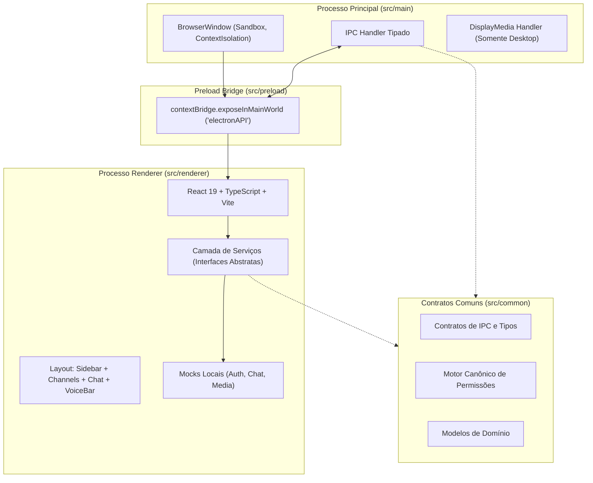

# Especificação Técnica — Etapa 6 (BASE): Shell Electron + React + TypeScript com Mocks Locais e IPC Seguro

**Data:** 2026-10-14  
**Etapa do Plano:** Etapa 6 (BASE — Preparar a base reproduzível)  
**Documentos de Origem:** `docs/planejamento/plano.md`, `docs/arquitetura/arquitetura-e-contratos.md`, Obsidian `Discord/05-PLANO-DE-EXECUCAO.md`  
**Rastreabilidade de Requisitos:** RF-01 (Windows 10/11 x64, pt-BR), RF-15 (empacotamento e distribuição privada), RF-16 (fronteiras do MVP)  
**Condição Financeira Vigente:** Gate E0 bloqueado para serviços de nuvem reais; desenvolvimento 100% local em modo mock com garantia R$0.

---

## 1. Visão Geral e Objetivos

O objetivo desta etapa é construir a fundação executável e testável do aplicativo desktop de comunicação para amigos, estabelecendo a base de código reprodutível antes das integrações completas de dados e mídia.

### Objetivos Concretos:
1. **Inicialização do Repositório Git Local:** Repositório Git local com `.gitignore` adequado, preservando rigorosamente o arquivo `AGENTS.md` e a configuração `.codex/`.
2. **Estrutura de Código Modular por Responsabilidade:**
   - `src/main/`: Processo principal Electron (segurança, janelas, IPC restrito, handlers de sistema).
   - `src/preload/`: Script de pré-carregamento com `contextBridge` estritamente tipado (sem vazamento de Node.js).
   - `src/renderer/`: Interface React 18/19 em TypeScript com Vite, estruturada no layout canônico do produto (servidores, canais, chat, barra de voz).
   - `src/common/`: Tipos compartilhados, contratos de IPC, interfaces de domínio e cálculo canônico de permissões.
   - `tests/`: Bateria de testes unitários automatizados com Vitest.
3. **Segurança do Electron:**
   - `contextIsolation: true`, `nodeIntegration: false`, `sandbox: true`.
   - Content Security Policy (CSP) rigorosa configurada nos cabeçalhos e meta tags.
   - IPC baseado em allowlist tipada — sem proxy genérico ou `eval`.
4. **Camada de Mocks Locais (Zero Custo):**
   - Mocks desacoplados para Auth (login mock com perfis simulados), Chat/Realtime (mensagens em memória com expiração lógica de 10 dias) e Mídia (estado simulado de sala de voz e transmissão de tela).
5. **Sincronização Dupla (Codex + Obsidian):**
   - Execução orientada aos perfis Codex (`devops`, `frontend`, `arquiteto`, `qa`, `revisor`).
   - Registro simultâneo de progresso na nota Obsidian `Discord/11-REGISTRO-DE-EXECUCAO.md` e atualização do status em `Discord/01-ESTADO.md`.

---

## 2. Arquitetura de Módulos e Componentes



### 2.1 Processo Principal (`src/main/`)
- **`index.ts`**: Ponto de entrada do Electron. Controla o ciclo de vida do app (`app.whenReady`, `window-all-closed`).
- **`window.ts`**: Cria e configura a `BrowserWindow` com dimensões mínimas (1024x720), título do app e webPreferences restritivas.
- **`ipc/`**: Módulos handlers para IPC:
  - `system-info.ts`: Retorna versão do app, sistema operacional e status de conexão.
  - `screen-capture.ts`: Registra `setDisplayMediaRequestHandler` para permitir compartilhamento exclusivo de telas e áudio do sistema com confirmação segura.

### 2.2 Preload Bridge (`src/preload/`)
- **`index.ts`**: Executa no contexto isolado do preload.
- Expõe a interface `Window.electronAPI` usando `contextBridge.exposeInMainWorld`:
  ```typescript
  export interface ElectronAPI {
    getAppVersion: () => Promise<string>;
    getSystemSources: () => Promise<Array<{ id: string; name: string; thumbnail?: string }>>;
    onSystemNotification: (callback: (event: string, data: unknown) => void) => () => void;
  }
  ```

### 2.3 Camada Compartilhada (`src/common/`)
- **`ipc-channels.ts`**: Enum ou constantes de canais permitidos (`APP_GET_VERSION`, `DESKTOP_GET_SOURCES`, etc.).
- **`domain/`**: Tipos de entidades (User, Guild/Community, Channel, Role, Message, VoiceState).
- **`permissions/`**: Implementação canônica da autorização do Discord (conforme `docs/arquitetura/arquitetura-e-contratos.md`), com testes completos de precedência (@everyone -> roles -> channel overrides -> user overrides).

### 2.4 Interface do Usuário (`src/renderer/`)
- **Estrutura de Pastas:**
  - `src/renderer/src/components/`:
    - `sidebar/`: Navegação entre comunidades e DMs.
    - `channels/`: Lista de canais de texto e canais de voz.
    - `chat/`: Área de mensagens com rolagem virtual, indicador de envio e janela de 10 dias.
    - `voice/`: Barra inferior de controle de áudio (microfone mute/unmute, áudio deafen, botão de transmitir tela).
    - `user/`: Perfil do usuário logado (avatar, tag, status de presença).
  - `src/renderer/src/services/`:
    - `auth.ts`: Interface de autenticação com implementação `MockAuthService` e `SupabaseAuthService`.
    - `chat.ts`: Interface de mensagens com implementação `MockChatService` (in-memory store com purga de 10 dias).
    - `voice.ts`: Interface de controle de voz e transmissão de tela com `MockVoiceService`.

---

## 3. Estratégia de Testes Automatizados (TDD)

A infraestrutura de testes utilizará **Vitest**:
1. **Testes de Permissões Canônicas (`tests/unit/permissions.test.ts`):**
   - Validação da ordem de precedência:
     1. Dono do servidor (Bypass total).
     2. ADMINISTRATOR (Bypass de permissões e overrides de canal).
     3. Overrides de @everyone (deny sobrescreve base).
     4. Overrides de cargos (roles).
     5. Overrides específicos de membro.
   - Verificação de hierarquia de cargos (gestor não pode promover membro para cargo igual ou superior ao seu).
   - Verificação de isolamento de DMs (nenhum cargo de servidor concede acesso a mensagens diretas).
2. **Testes dos Contratos IPC e Validação (`tests/unit/ipc-contracts.test.ts`):**
   - Garantir que mensagens inválidas ou payloads fora do schema são rejeitados.
3. **Testes da Política de Retenção de 10 Dias (`tests/unit/retention.test.ts`):**
   - Garantir que mensagens com `created_at > 10 dias` nunca são retornadas nas consultas paginadas, mesmo presentes em armazenamento bruto.

---

## 4. Gestão de Dependências e Tooling

- **Linguagem & Runtime:** Node.js v26.x, TypeScript 5.x.
- **Framework Desktop:** Electron 35.x.
- **Frontend:** React 19, Vite 6.x.
- **Testes:** Vitest.
- **Scripts em `package.json`:**
  - `npm run dev`: Inicia o Vite dev server e o Electron em modo hot-reload.
  - `npm run build`: Compila TypeScript (main, preload, renderer) e empacota artefato estático via Vite.
  - `npm test`: Executa a suíte de testes Vitest no console (CI-ready).
  - `npm run lint`: Executa TypeScript typecheck (`tsc --noEmit`).

---

## 5. Rastreabilidade com Codex e Sincronização Obsidian

A execução dos blocos de trabalho seguirá rigorosamente o modelo de tarefas do Codex:
- **DevOps:** Inicialização do Git, configuração do `package.json`, TypeScript, Vite, Electron main/preload e scripts de build.
- **Arquiteto / Dados:** Criação dos contratos compartilhados (`src/common/`), tipos de domínio e motor de permissões com testes unitários.
- **Frontend:** Scaffolding do React 19, componentes de UI, temas e serviços mock.
- **QA:** Verificação e execução de testes automatizados Vitest.
- **Revisor / Principal:** Parecer independente, commit das alterações e registro nas notas Obsidian `Discord/11-REGISTRO-DE-EXECUCAO.md` e `Discord/01-ESTADO.md`.
