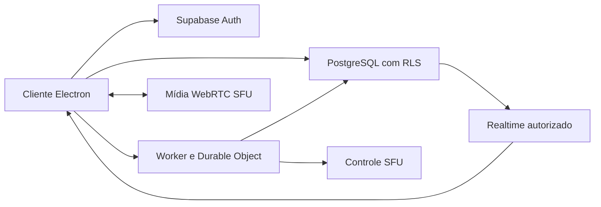

# Arquitetura e contratos do aplicativo desktop de comunicação

Este documento registra a arquitetura candidata do plano autorizado. Não comprova integração, desempenho, elegibilidade de contas ou custo zero. O gate E0 precede a prova de mídia e a implementação completa. Consulte [o plano](../planejamento/plano.md), [os requisitos](../produto/requisitos-e-aceite.md) e [o relatório E0](../validacao/e0-financeiro.md).

## Decisões que vinculam a implementação

- Windows 10/11 x64; português; identidade Google via Supabase Auth.
- Capacidade esperada: 20 online, uma chamada global com até 10 pessoas e uma transmissão com até nove espectadores.
- Uso: 120 horas mensais da chamada e 60 horas da transmissão dentro dessas chamadas, não horas por participante.
- Tela 720p/30 fps e som do sistema. Voz e transmissão continuam no MVP.
- Mensagens disponíveis por dez dias. Histórico acompanha a visibilidade do canal; não há controle independente READ_MESSAGE_HISTORY no MVP.
- DMs individuais somente entre amigos. Sem edição, anexos, webcam, gravação ou voz por DM.
- Sem backup textual das mensagens. Distribuição privada e atualização manual.
- R$0 prioritário; interromper mídia preventivamente, sem contratar ou degradar silenciosamente.

## Componentes e fronteiras

| Componente | Responsabilidade | Autoridade |
| --- | --- | --- |
| Electron main/preload | Sessão desktop, ponte IPC mínima, armazenamento protegido de sessão, dispositivos e escolha de captura | Não concede permissão de comunidade ou mídia |
| React/TypeScript renderer | Navegação, estados e WebRTC | Usa capacidades recebidas; não é fonte de autorização |
| Supabase Auth/PostgreSQL | Identidade, comunidades, cargos, mensagens, amizades e DMs | RLS e avaliação atual de permissões |
| Supabase Realtime | Atualização autorizada de dados e presença efêmera | Presença não comprova participação na chamada |
| Worker + Durable Object SQLite | Chamada global, reservas, negociação, revalidação e limpeza remota | Consulta permissões atuais no PostgreSQL |
| Cloudflare Realtime SFU | Encaminhamento de voz, tela e som | Não fornece sozinho comunidade, cargos ou isolamento de usuários |
| GitHub privado | Código, verificações e instaladores | Não hospeda backend permanente |

O Worker não duplicará CRUD de mensagens ou comunidades já protegido por RLS. O Durable Object coordena a sala, não substitui o banco de domínio. A classe SQLite é candidata compatível com Workers Free; suas próprias cotas precisam passar no E0.

## Autorização canônica

O backend calcula permissões efetivas por conjuntos de ações, com a precedência documental do Discord para as funções suportadas:

1. Confirmar identidade válida e participação atual na comunidade.
2. Dono recebe as ações administrativas do domínio. Administrator ignora exceções de canal.
3. Unir permissões de @everyone e dos cargos do membro.
4. Aplicar negações e depois concessões de @everyone no canal.
5. Unir todas as negações de cargos e removê-las; unir todas as concessões de cargos e aplicá-las.
6. Aplicar negações e depois concessões específicas do membro.
7. Verificar pré-requisitos da ação e as restrições operacionais.

Uma concessão de cargo pode prevalecer sobre a negação de outro cargo; sua posição não muda esse cálculo. Hierarquia limita administração e expulsão. Administrador não acessa DMs alheias e não ignora limites financeiros, capacidade ou estado da conta.

| Ação | Uso no MVP |
| --- | --- |
| ADMINISTRATOR | Administração e bypass de exceções de canal |
| MANAGE_GUILD | Gestão da comunidade |
| MANAGE_CHANNELS | Criação e alteração de canais |
| MANAGE_ROLES | Cargos, atribuições e gestão de exceções autorizadas |
| MANAGE_MESSAGES | Exclusão de mensagem de terceiro no canal |
| KICK_MEMBERS | Remoção de membro inferior na hierarquia |
| CREATE_INSTANT_INVITE | Emissão de convite |
| VIEW_CHANNEL | Ver canal e seu histórico de dez dias |
| SEND_MESSAGES | Enviar texto quando também pode ver o canal |
| CONNECT | Entrar/receber voz quando também pode ver o canal |
| SPEAK | Publicar microfone em conexão autorizada |
| STREAM | Publicar tela/som em conexão autorizada e com reserva |

MANAGE_CHANNELS sozinho não permite alterar exceções de permissão. Um gestor não modifica/atribui cargos iguais ou superiores ao seu cargo máximo nem concede poder que não possui. O dono é protegido. DMs usam participação própria, amizade e bloqueio; não herdam cargos de comunidades.

Uma avaliação canônica no PostgreSQL serve a RLS e ao controlador de mídia. O cliente pode receber a lista de ações para apresentar controles, mas toda mutação confirma autorização atual novamente.

## Contratos mínimos de mídia

Estes nomes descrevem contratos propostos, não APIs já existentes. Identidade vem do JWT validado, nunca de user_id declarado pelo cliente.

| Operação | Entrada | Saída/efeito exigido |
| --- | --- | --- |
| joinMedia | channelId, requestId | Associação opaca, geração da conexão, capacidades atuais e publicações permitidas |
| publishMedia | memberId, generation, kind, sdp | Publicação autorizada de microphone, screen ou system_audio |
| subscribeMedia | memberId, generation, publicationIds | Apenas publicações permitidas da mesma chamada |
| answerNegotiation | memberId, generation, operationId, sdp | Resposta vinculada ao proprietário e operação atuais |
| stopShare | memberId | Liberação idempotente da tela e som após limpeza remota |
| leaveMedia | memberId | Encerramento idempotente de publicações e recepções |
| getBudgetState | Contexto autenticado | Saldo operacional, estado e motivo de bloqueio |

O controlador gera e relaciona identificadores do provedor. Não oferecer proxy genérico da API Cloudflare. Cada mutação valida propriedade, geração, participação, ação, exclusividade da tela e orçamento. Serializar mutações SDP por sessão até a negociação terminar; limpar alocações tardias após cancelamento/revogação.

Eventos de controle usam snapshots versionados, alterações de publicações, revogação e interrupção por cota. Credenciais administrativas nunca chegam ao renderer ou instalador.

## Revogação e reconexão

- Revalidar permissões de participantes em lote a cada dois segundos durante chamada, sujeito à medição das cotas no experimento.
- Objetivo do teste: novos pacotes deixam de chegar em até cinco segundos após revogação, mesmo se o cliente ignorar o evento.
- Fechar publicações e recepções remotas pelo mecanismo documentado tracks/close com force=true. Verificar o resultado de cada track; HTTP 200 não prova limpeza integral.
- Uma ordem no cliente, remoção de presença ou expiração de token de sinalização não prova encerramento de WebRTC já estabelecido.
- Guardar limpezas pendentes e tratar resposta tardia de negociação. Não declarar a saída concluída antes da confirmação exigida pelo contrato.
- Identificadores de reenvio impedem duplicação de mensagem/reserva; gerações impedem reutilização de negociações antigas.

Supabase Broadcast/Presence pode conservar autorização em cache até renovação/expiração. Não transportar conteúdo privado cuja proteção dependa exclusivamente dessa associação mutável. A estratégia candidata é Postgres Changes com RLS atual, seguida de reconciliação por consulta autorizada; deve passar em teste com conexão/JWT antigos.

## Retenção e recuperação

Leitura autorizada de mensagem inclui created_at na janela móvel de dez dias. A disponibilidade não depende da execução da limpeza física; purga periódica remove registros vencidos. Limpar também conteúdo vencido em memória do cliente. Não persistir corpos de mensagens em caches, logs, dumps ou exportações do projeto.

Backup diário cifrado do domínio usa lista explícita de tabelas permitidas e exclui messages/dm_messages. A recuperação não promete restaurar conversas. Identidade e acesso precisam ser reconciliados pelo procedimento de restauração testado. Políticas internas de cópias dos provedores permanecem não verificadas.

## Dimensionamento candidato

GB decimal de payload = bitrate_kbps × destinatários × horas × 3600 / 8000000.

| Track | Premissa | Payload mensal |
| --- | --- | --- |
| Microfones | 10 × 9 destinos × 32 kbps × 120 h | 155,520 GB |
| Tela | 9 destinos × 1500 kbps × 60 h | 364,500 GB |
| Som do sistema | 9 destinos × 96 kbps × 60 h | 23,328 GB |
| Total | Cenário fechado | 543,348 GB |
| Total com 30% adicional | Hipótese de margem | 706,3524 GB |

Alvo candidato de vídeo: até 1,5 Mbps para ensaio 720p/30 fps. Microfone Opus 32 kbps mono e sistema 96 kbps estéreo são parâmetros de experimento, não qualidade validada. Orçamento operacional candidato: 800 GB por ciclo, ajustado ao saldo compartilhado da conta. Margem de 30% não é limite físico de overhead.

Bloqueio e encerramento serão controlados no servidor. Bitrate informado pelo cliente, estatísticas locais e alertas não são teto financeiro. Falha do controlador ou esgotamento de suas cotas pode deixar mídia ativa; sem resposta comprovada para esse risco, E0 não passa.

## Evidências e fontes

Consulta documental em 2026-10-14, durante o planejamento. Condições reais das contas, desempenho e captura não foram validados nesta elaboração.

- [Permissões Discord](https://docs.discord.com/developers/topics/permissions)
- [Gestão de exceções de canal](https://docs.discord.com/developers/resources/channel#edit-channel-permissions)
- [Supabase Realtime authorization](https://supabase.com/docs/guides/realtime/authorization)
- [Supabase preços](https://supabase.com/pricing)
- [Cloudflare SFU preços](https://developers.cloudflare.com/realtime/sfu/platform/pricing/)
- [Cloudflare budget alerts](https://developers.cloudflare.com/billing/manage/budget-alerts/)
- [Durable Objects preços](https://developers.cloudflare.com/durable-objects/platform/pricing/)
- [Fechamento de tracks](https://developers.cloudflare.com/realtime/sfu/get-started/connection-patterns/#close-media-tracks)
- [Electron captura](https://www.electronjs.org/docs/latest/api/session#sessetdisplaymediarequesthandlerhandler-opts)
- [Electron segurança](https://www.electronjs.org/docs/latest/tutorial/security)
- [Login Google](https://supabase.com/docs/guides/auth/social-login/auth-google)
- [GitHub Actions billing](https://docs.github.com/en/billing/concepts/product-billing/github-actions)
