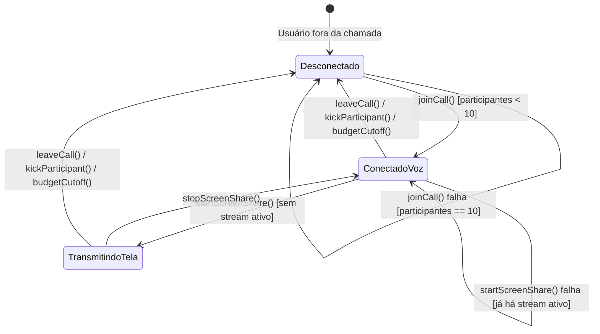

# Especificação Técnica — Etapa 10 (MEDIA): Voz, Tela, Som e Controle de Capacidade

**Data:** 2026-10-14  
**Etapa do Plano:** Etapa 10 (MEDIA — Integrar voz, tela e som ao produto)  
**Documentos de Origem:** `docs/planejamento/plano.md`, `docs/arquitetura/arquitetura-e-contratos.md`, `docs/produto/requisitos-e-aceite.md`  
**Rastreabilidade de Requisitos:** RF-09 / AC-09 (20 online, uma chamada global, 10 participantes, disputa e recusa do 11º), RF-10 / AC-10 (Dispositivos, mute/deafen, reconexão e expulsão em até 5s), RF-11 / AC-11 (Uma tela, 720p/30fps, som do sistema, 9 espectadores e disputa), RF-12 / AC-12 (Orçamento e corte preventivo), RF-16 (Fronteiras do MVP: sem webcam, gravação ou voz por DM), Prioridade R$0 (Desenvolvimento e testes locais).

---

## 1. Visão Geral e Fronteiras

A Etapa 10 estabelece o controlador de sessão de mídia e reservas de capacidade no Discord Desktop.
Conforme as restrições arquiteturais vinculantes:
1. **Gate E0 e Serviços Reais:**
   - Mídia WebRTC externa real e Cloudflare Calls SFU continuam condicionadas à aprovação prévia do relatório financeiro E0 e ensaios E1/E2.
   - O desenvolvimento atual implementa o **controlador canônico de chamadas, reservas de mídia e estado do cliente (`DesktopCallController` / `DesktopMediaService`)** operando em modelo mock verificável sob prioridade R$0.
2. **Controle de Capacidade da Chamada Global (RF-09 / AC-09):**
   - **Uma única chamada ativa:** O sistema suporta exatamente uma chamada ativa por vez. Tentativa de iniciar chamada em outro canal ou guilda sem encerrar a existente é recusada ou requer transferência.
   - **Capacidade máxima de 10 participantes:** No máximo 10 pessoas podem participar da chamada de voz simultaneamente.
   - **Recusa do 11º participante:** Quando a sala atinge 10 membros, qualquer tentativa adicional de entrada é rejeitada com o erro `CAPACIDADE_CHAMADA_EXCEDIDA`.
   - **Liberação imediata:** Ao desconectar, a vaga é liberada instantaneamente para outros participantes.
3. **Reserva Exclusiva de Transmissão de Tela (RF-11 / AC-11):**
   - **Apenas uma transmissão por chamada:** No máximo 1 participante pode transmitir tela por vez.
   - **Concorrência e disputa:** Tentativa de um segundo participante iniciar transmissão enquanto outra estiver ativa é rejeitada com `TRANSMISSAO_JA_ATIVA`.
   - **Espectadores:** Até 9 espectadores (todos os outros membros da chamada podem assistir ao stream).
   - **Encerramento:** Parar a transmissão libera a vaga imediatamente para outro apresentador.
4. **Controles de Áudio e Dispositivos (RF-10 / AC-10):**
   - Microfone mutado (`isMuted: boolean`).
   - Modo surdo (`isDeafened: boolean`), onde ativar `deafen` automaticamente muta o microfone do participante.
   - Enumeração e seleção de dispositivos simulados (microfone e alto-falante).
5. **Expulsão Remota e Corte Preventivo (RF-10 / RF-12):**
   - **Expulsão / Revogação de permissão:** Se um membro perde a permissão `CONNECT` ou for expulso da chamada (`kickParticipant`), sua conexão é abortada no cliente em até 5 segundos e a vaga é devolvida ao pool.
   - **Corte preventivo por orçamento:** Simulação de controle financeiro onde atingir o teto de horas (ex: simulação de esgotamento) aciona o desligamento remoto de todos os participantes sem excedentes.

---

## 2. Diagrama de Estados da Chamada e Transmissão



---

## 3. Contratos de Tipos e Interfaces (`src/common/media-types.ts`)

```typescript
import type { VoiceParticipant } from './types';

export interface AudioDevice {
  deviceId: string;
  label: string;
  kind: 'audioinput' | 'audiooutput';
}

export interface CallState {
  channelId: string | null;
  guildId: string | null;
  participants: VoiceParticipant[];
  activeScreenShareUserId: string | null;
  startedAt: number | null;
}

export interface CallController {
  joinCall(channelId: string, guildId: string, userId: string, displayName: string): Promise<boolean>;
  leaveCall(userId: string): Promise<void>;
  startScreenShare(userId: string): Promise<boolean>;
  stopScreenShare(userId: string): Promise<void>;
  setMute(userId: string, isMuted: boolean): Promise<void>;
  setDeafen(userId: string, isDeafened: boolean): Promise<void>;
  kickParticipant(targetUserId: string, actorId: string, actorPermissions: bigint): Promise<boolean>;
  getCallState(): CallState;
  getAudioDevices(): Promise<AudioDevice[]>;
  setAudioDevice(kind: 'audioinput' | 'audiooutput', deviceId: string): Promise<void>;
  triggerEmergencyBudgetCutoff(): Promise<void>;
  onCallStateUpdated(callback: (state: CallState) => void): () => void;
}
```

---

## 4. Regras e Casos de Borda

1. **Chamada Única Global:**
   - Se uma chamada já estiver ativa no canal `chan-A` da guilda `guild-1` e outro usuário tentar iniciar chamada no canal `chan-B`, o sistema rejeita a segunda chamada com `CHAMADA_GLOBAL_EM_ANDAMENTO`, a não ser que todos os participantes anteriores tenham saído.
2. **Capacidade Máxima Estrita:**
   - O 11º participante é estritamente rejeitado com `CAPACIDADE_CHAMADA_EXCEDIDA`.
3. **Disputa de Transmissão:**
   - Usuário A transmitindo -> Usuário B tenta transmitir -> Rejeitado com `TRANSMISSAO_JA_ATIVA`.
   - Se Usuário A sai da chamada ou é desconectado, `activeScreenShareUserId` é limpo imediatamente.
4. **Cascata Deafen -> Mute:**
   - Ativar `deafen` forçará `isMuted = true`. Desativar `deafen` mantém o mute até o usuário explicitamente desmutar o microfone.
5. **Corte Remoto por Expulsão ou Orçamento:**
   - Qualquer participante desconectado remotamente emite notificação e limpa estado local em tempo <= 5000 ms.
