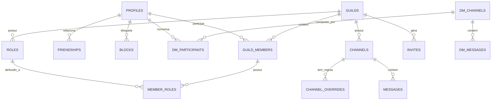

# Especificação Técnica — Etapa 7 (DATA): Persistência, Migrations PostgreSQL, RLS e Retenção

**Data:** 2026-10-14  
**Etapa do Plano:** Etapa 7 (DATA — Implementar dados, permissões e retenção)  
**Documentos de Origem:** `docs/planejamento/plano.md`, `docs/arquitetura/arquitetura-e-contratos.md`, Obsidian `Discord/05-PLANO-DE-EXECUCAO.md`, `Discord/07-ARQUITETURA-E-CONTRATOS.md`  
**Rastreabilidade de Requisitos:** RF-02 (identidade), RF-03 (comunidades), RF-04 (permissões), RF-05/RF-13 (retenção de 10 dias), RF-06 (texto simples sem edição), RF-07 (amizades, DMs e bloqueios), RF-14 (backup sem mensagens), RF-16 (fronteiras do MVP)  
**Condição Financeira Vigente:** R$0 — Migrations SQL e scripts de backup/purga testáveis localmente e compatíveis com Supabase/PostgreSQL 15+.

---

## 1. Visão Geral e Fronteiras

A camada de dados é responsável pela persistência relacional com integridade estrita, isolamento através de Row-Level Security (RLS) e garantia das políticas de privacidade e retenção decididas para o aplicativo:
1. **Identidade e Perfis:** Vínculo automático entre `auth.users` e a tabela pública `profiles`.
2. **Estrutura de Comunidades:** `guilds`, `channels`, `roles`, `guild_members`, `member_roles`, `channel_overrides` e `invites`.
3. **Comunicação por Texto:** Tabelas `messages` (comunidades) e `dm_messages` (mensagens diretas).
4. **Relacionamentos e DMs:** Tabelas `friendships`, `blocks`, `dm_channels`, `dm_participants`.
5. **Retenção de 10 Dias (RF-13):**
   - Disponibilidade lógica via RLS e views: mensagens criadas há mais de 10 dias (`created_at < now() - interval '10 days'`) são invisíveis em qualquer SELECT de usuário comum.
   - Procedimento SQL de purga física periódica (`purge_expired_messages()`).
6. **Política de Backup Seguro (RF-14):**
   - Script de exportação com lista explícita de tabelas permitidas (`ALLOWLIST`).
   - Bloqueio estrito de `messages` e `dm_messages` no dump de backup para impedir armazenamento persistente de texto além dos 10 dias.
7. **Isolamento de DMs:** Administradores de comunidades não herdam acesso a DMs de terceiros.

---

## 2. Diagrama Entidade-Relacionamento (ERD)



---

## 3. Esquema Relacional e Constraints

### 3.1 Tabelas de Identidade e Amizade
- **`profiles`**: `id` (UUID, PK referenciando `auth.users`), `username` (VARCHAR 32, UNIQUE, NOT NULL), `display_name` (VARCHAR 64, NOT NULL), `avatar_url` (TEXT), `created_at` (TIMESTAMPTZ NOT NULL DEFAULT now()).
- **`friendships`**: `user_id` (UUID, PK), `friend_id` (UUID, PK), `status` (VARCHAR: 'pending', 'accepted'), `created_at` (TIMESTAMPTZ DEFAULT now()). Constraint: `user_id <> friend_id`.
- **`blocks`**: `blocker_id` (UUID, PK), `blocked_id` (UUID, PK), `created_at` (TIMESTAMPTZ DEFAULT now()). Constraint: `blocker_id <> blocked_id`.

### 3.2 Tabelas de Comunidades e Permissões
- **`guilds`**: `id` (UUID, PK), `name` (VARCHAR 100 NOT NULL), `owner_id` (UUID NOT NULL REFERENCES profiles(id)), `created_at` (TIMESTAMPTZ DEFAULT now()).
- **`channels`**: `id` (UUID, PK), `guild_id` (UUID NOT NULL REFERENCES guilds(id) ON DELETE CASCADE), `name` (VARCHAR 100 NOT NULL), `type` (VARCHAR 20 NOT NULL DEFAULT 'text'), `topic` (TEXT), `position` (INT NOT NULL DEFAULT 0), `created_at` (TIMESTAMPTZ DEFAULT now()).
- **`roles`**: `id` (UUID, PK), `guild_id` (UUID NOT NULL REFERENCES guilds(id) ON DELETE CASCADE), `name` (VARCHAR 100 NOT NULL), `position` (INT NOT NULL DEFAULT 0), `permissions` (NUMERIC NOT NULL DEFAULT 0), `color` (VARCHAR 7), `created_at` (TIMESTAMPTZ DEFAULT now()).
- **`guild_members`**: `guild_id` (UUID, PK), `user_id` (UUID, PK), `nickname` (VARCHAR 64), `joined_at` (TIMESTAMPTZ DEFAULT now()).
- **`member_roles`**: `guild_id` (UUID), `user_id` (UUID), `role_id` (UUID), PK(guild_id, user_id, role_id).
- **`channel_overrides`**: `channel_id` (UUID), `target_id` (UUID), `target_type` (VARCHAR 10 CHECK in ('role', 'member')), `allow` (NUMERIC NOT NULL DEFAULT 0), `deny` (NUMERIC NOT NULL DEFAULT 0), PK(channel_id, target_id).
- **`invites`**: `code` (VARCHAR 16, PK), `guild_id` (UUID NOT NULL REFERENCES guilds(id) ON DELETE CASCADE), `creator_id` (UUID NOT NULL REFERENCES profiles(id)), `expires_at` (TIMESTAMPTZ), `max_uses` (INT), `uses` (INT DEFAULT 0), `created_at` (TIMESTAMPTZ DEFAULT now()).

### 3.3 Mensagens e DMs (com Regra de 10 Dias)
- **`messages`**:
  - `id` (UUID, PK DEFAULT gen_random_uuid()),
  - `channel_id` (UUID NOT NULL REFERENCES channels(id) ON DELETE CASCADE),
  - `author_id` (UUID NOT NULL REFERENCES profiles(id)),
  - `content` (TEXT NOT NULL CHECK (length(content) > 0 AND length(content) <= 2000)),
  - `created_at` (TIMESTAMPTZ NOT NULL DEFAULT now()),
  - `is_deleted` (BOOLEAN NOT NULL DEFAULT false).
  - **Index de Retenção:** `CREATE INDEX idx_messages_retention ON messages(channel_id, created_at) WHERE is_deleted = false;`
- **`dm_channels`**: `id` (UUID, PK DEFAULT gen_random_uuid()), `created_at` (TIMESTAMPTZ DEFAULT now()).
- **`dm_participants`**: `dm_channel_id` (UUID REFERENCES dm_channels(id) ON DELETE CASCADE), `user_id` (UUID REFERENCES profiles(id)), PK(dm_channel_id, user_id).
- **`dm_messages`**:
  - `id` (UUID, PK DEFAULT gen_random_uuid()),
  - `dm_channel_id` (UUID NOT NULL REFERENCES dm_channels(id) ON DELETE CASCADE),
  - `author_id` (UUID NOT NULL REFERENCES profiles(id)),
  - `content` (TEXT NOT NULL CHECK (length(content) > 0 AND length(content) <= 2000)),
  - `created_at` (TIMESTAMPTZ NOT NULL DEFAULT now()),
  - `is_deleted` (BOOLEAN NOT NULL DEFAULT false).

---

## 4. Políticas de Row-Level Security (RLS)

1. **`profiles`:**
   - SELECT: Público para usuários autenticados.
   - UPDATE: Apenas o próprio usuário (`auth.uid() = id`).
2. **`messages`:**
   - SELECT: Membro do canal com permissão `VIEW_CHANNEL` E mensagem dentro da janela de 10 dias (`created_at >= now() - interval '10 days'`). Mensagens deletadas (`is_deleted = true`) são excluídas.
   - INSERT: Membro do canal com permissão `SEND_MESSAGES` e `VIEW_CHANNEL`, com `author_id = auth.uid()`.
   - UPDATE: Proibido (sem edição no MVP, decisão D-06).
   - DELETE: Apenas autor (`author_id = auth.uid()`) ou membro com `MANAGE_MESSAGES` (soft delete via `is_deleted = true`).
3. **`dm_messages`:**
   - SELECT / INSERT: Apenas participantes registrados em `dm_participants` para o `dm_channel_id`, desde que não haja bloqueio ativo entre os participantes e dentro do limite de 10 dias.
   - Administradores de comunidades **não têm política de leitura em DMs**.

---

## 5. Procedimentos de Retenção e Backup

### 5.1 Função de Purga Periódica
```sql
CREATE OR REPLACE FUNCTION purge_expired_messages() RETURNS integer AS $$
DECLARE
  deleted_count integer := 0;
  cutoff_time timestamptz := now() - interval '10 days';
BEGIN
  -- Remove fisicamente mensagens expiradas das duas tabelas
  WITH deleted_guild_msgs AS (
    DELETE FROM messages WHERE created_at < cutoff_time RETURNING 1
  )
  SELECT count(*) INTO deleted_count FROM deleted_guild_msgs;

  DELETE FROM dm_messages WHERE created_at < cutoff_time;

  RETURN deleted_count;
END;
$$ LANGUAGE plpgsql SECURITY DEFINER;
```

### 5.2 Script de Backup com Allowlist Estrita (RF-14)
- Lista explícita de tabelas incluídas no backup:
  `profiles`, `friendships`, `blocks`, `guilds`, `guild_members`, `roles`, `member_roles`, `channels`, `channel_overrides`, `invites`, `dm_channels`, `dm_participants`.
- **Tabelas Proibidas:** `messages` e `dm_messages`.
- O script `scripts/backup_db.py` gera o comando `pg_dump` garantindo que nenhuma tabela de mensagem seja incluída, mesmo que novas tabelas surjam no schema.

---

## 6. Estratégia de Testes Automatizados da Etapa 7

1. **`tests/unit/data-schema.test.ts`**:
   - Valida que todos os arquivos `.sql` de migrations existem, possuem sintaxe válida e declaram as constraints esperadas.
2. **`tests/unit/retention-policy.test.ts`**:
   - Valida que a consulta SQL filtra estritamente mensagens anteriores a 10 dias.
   - Valida que a função `purge_expired_messages` atua com o corte correto.
3. **`tests/unit/backup-allowlist.test.ts`**:
   - Valida que o script de backup possui allowlist fechada e que as tabelas de mensagens são explicitamente bloqueadas.
