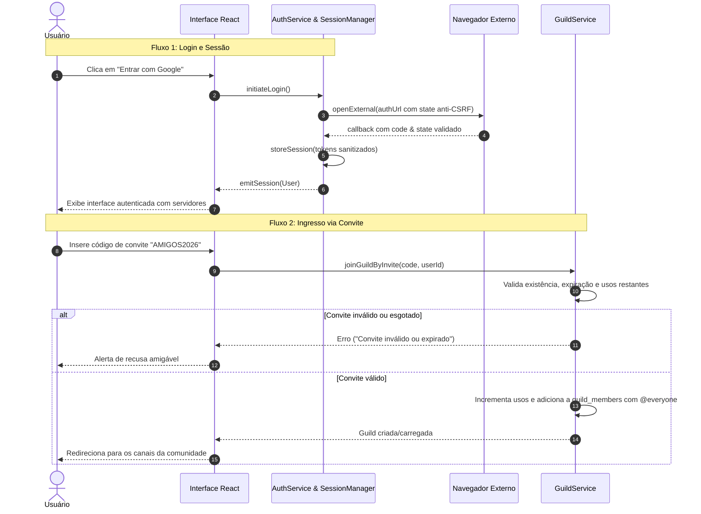

# Especificação Técnica — Etapa 8 (IDENTITY): Identidade, Autenticação e Comunidades

**Data:** 2026-10-14  
**Etapa do Plano:** Etapa 8 (IDENTITY — Integrar identidade e comunidades)  
**Documentos de Origem:** `docs/planejamento/plano.md`, `docs/arquitetura/arquitetura-e-contratos.md`, `docs/produto/requisitos-e-aceite.md`, `supabase/migrations/20261014000001_initial_schema.sql`  
**Rastreabilidade de Requisitos:** RF-02 / AC-02 (Login Google, retorno seguro, persistência protegida de sessão, falha e logout), RF-03 / AC-03 (Comunidades, membros, convites, canais e recusa de convites inválidos), RF-04 / AC-04 (Cargos, exceções, hierarquia e precedência), RF-16 (Fronteiras do MVP), Prioridade R$0 (Desenvolvimento e testes offline locais).

---

## 1. Visão Geral e Fronteiras

A Etapa 8 estabelece a camada de gerenciamento de identidade e comunidades no Discord Desktop:
1. **Autenticação e Sessão (RF-02):**
   - Provedor de autenticação com suporte a fluxo externo Google OAuth via navegador e mock offline verificável para desenvolvimento local sem custos de nuvem.
   - Retorno seguro com validação de parâmetros (state anti-CSRF, tokens) e proteção contra replay.
   - Gerenciamento de sessão com persistência protegida no cliente (sanitização de credenciais, sem tokens expostos em logs).
   - Restauração automática de sessão válida na inicialização do aplicativo.
   - Logout seguro com expiração de sessão e limpeza completa do estado local.
2. **Gerenciamento de Comunidades e Membros (RF-03):**
   - Criação de comunidade (`guild`): geração de ID, associação do criador como dono (`owner`), criação automática do cargo base `@everyone` e do canal textual padrão `#geral`.
   - Listagem de comunidades associadas ao usuário autenticado.
   - Associação de membros a comunidades com suporte a apelidos (`nickname`).
3. **Sistema de Convites com Validação Estrita (RF-03 / AC-03):**
   - Geração de convites com código alfanumérico único, limite de usos (`max_uses`) e prazo de expiração (`expires_at`), exigindo permissão `CREATE_INSTANT_INVITE`.
   - Validação antes de ingresso: recusa de código inexistente, código expirado ou que atingiu o limite de usos.
   - Idempotência: caso o usuário já seja membro, retorna a comunidade sem duplicar registros ou incrementar indevidamente o uso.
4. **Canais e Autorização de Acesso (RF-03 / RF-04):**
   - Criação e exclusão de canais (texto e voz) restrita a atores com permissão `MANAGE_CHANNELS`.
   - Filtragem de canais visíveis no cliente de acordo com a avaliação canônica de `VIEW_CHANNEL`.
5. **Cargos e Hierarquia de Administração (RF-04 / AC-04):**
   - Criação e atualização de cargos respeitando `MANAGE_ROLES`.
   - Aplicação de regras de hierarquia (`canManageRole`): nenhum administrador pode gerenciar, atribuir ou remover cargos de posição igual ou superior ao seu cargo mais alto (salvo o dono da comunidade).
6. **Integração na Interface (UI / Renderer):**
   - Navegação na barra lateral (`Sidebar`) entre comunidades e DMs.
   - Painel de membros e modal/fluxo de convites.
   - Telas de estado: não autenticado (login), carregando, sem comunidades (vazio) e comunidade ativa.

---

## 2. Diagrama de Fluxo de Autenticação e Entrada em Comunidade



---

## 3. Contratos de Tipos e Interfaces

### 3.1 Sessão e Autenticação (`src/common/auth-types.ts`)

```typescript
export interface AuthSession {
  user: User;
  token: string;
  expiresAt: number; // Unix epoch ms
  refreshToken?: string;
}

export interface LoginParams {
  provider: 'google' | 'mock';
  mockUsername?: string;
}

export interface SessionStorageAdapter {
  load(): Promise<AuthSession | null>;
  save(session: AuthSession): Promise<void>;
  clear(): Promise<void>;
}

export interface AuthService {
  login(params?: LoginParams): Promise<User>;
  restoreSession(): Promise<User | null>;
  logout(): Promise<void>;
  getCurrentUser(): User | null;
  onAuthStateChanged(callback: (user: User | null) => void): () => void;
}
```

### 3.2 Comunidades, Convites e Cargos (`src/common/guild-types.ts`)

```typescript
import type { Guild, GuildMember, Channel, Role, ChannelType } from './types';

export interface CreateGuildParams {
  name: string;
  ownerId: string;
  iconUrl?: string;
}

export interface CreateChannelParams {
  guildId: string;
  name: string;
  type: ChannelType;
  actorId: string;
  topic?: string;
}

export interface CreateInviteParams {
  guildId: string;
  creatorId: string;
  maxUses?: number;
  expiresInMs?: number; // Duração até expirar
}

export interface InviteInfo {
  code: string;
  guildId: string;
  guildName: string;
  creatorId: string;
  expiresAt: number | null; // epoch ms
  maxUses: number | null;
  uses: number;
}

export interface CreateRoleParams {
  guildId: string;
  name: string;
  position: number;
  permissions: bigint;
  color?: string;
  actorId: string;
}

export interface AssignRoleParams {
  guildId: string;
  targetUserId: string;
  roleId: string;
  actorId: string;
}

export interface GuildService {
  createGuild(params: CreateGuildParams): Promise<Guild>;
  getGuild(guildId: string): Promise<Guild | null>;
  getUserGuilds(userId: string): Promise<Guild[]>;
  getGuildMembers(guildId: string): Promise<GuildMember[]>;
  createChannel(params: CreateChannelParams): Promise<Channel>;
  getGuildChannels(guildId: string, actorId: string): Promise<Channel[]>;
  createInvite(params: CreateInviteParams): Promise<InviteInfo>;
  getInvite(code: string): Promise<InviteInfo | null>;
  joinGuildByInvite(code: string, userId: string): Promise<Guild>;
  createRole(params: CreateRoleParams): Promise<Role>;
  assignRole(params: AssignRoleParams): Promise<boolean>;
  removeRole(params: AssignRoleParams): Promise<boolean>;
}
```

---

## 4. Regras de Negócio e Casos de Borda

1. **Anti-CSRF e Segurança de Retorno:**
   - Em requisições de login Google, gerar um `state` criptograficamente aleatório e verificá-lo no retorno. Se o state for discrepante ou ausente, a autenticação deve falhar explicitamente.
2. **Validação de Convites:**
   - Convites com `max_uses <= uses` são rejeitados com erro `CONVITE_ESGOTADO`.
   - Convites com `expires_at <= now` são rejeitados com erro `CONVITE_EXPIRADO`.
   - Convites inexistentes geram erro `CONVITE_INEXISTENTE`.
   - Usuário que já é membro da comunidade tem o retorno da comunidade confirmado sem erro e sem consumir usos adicionais.
3. **Hierarquia de Cargos:**
   - O dono (`owner`) da guilda tem imunidade e permissão absoluta para criar/atribuir qualquer cargo.
   - Usuários não-donos, mesmo com permissão `MANAGE_ROLES`, não podem criar, editar, atribuir ou revogar cargos cuja `position >=` a maior `position` dos cargos do próprio ator.
4. **Isolamento de Canais:**
   - A listagem de canais para um usuário deve filtrar canais privados cujo cálculo canônico (`computePermissions`) resulte em negação de `VIEW_CHANNEL`.
5. **Ambiente R$0 e Mocks:**
   - Todas as operações devem ser 100% testáveis via unit tests em Vitest sem depender de rede externa ou de instâncias de nuvem pagas.
