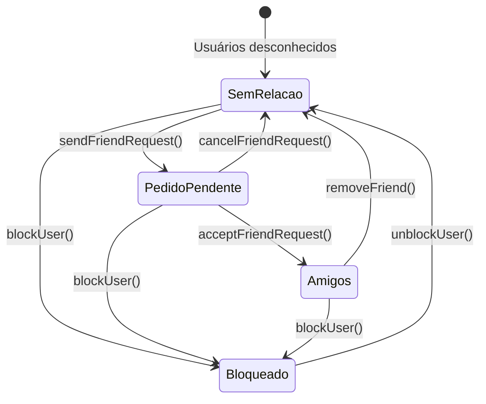

# Especificação Técnica — Etapa 9 (TEXT): Mensagens, Amizades, DMs e Presença

**Data:** 2026-10-14  
**Etapa do Plano:** Etapa 9 (TEXT — Entregar texto, amizades, DMs e presença)  
**Documentos de Origem:** `docs/planejamento/plano.md`, `docs/arquitetura/arquitetura-e-contratos.md`, `docs/produto/requisitos-e-aceite.md`, `supabase/migrations/20261014000001_initial_schema.sql`  
**Rastreabilidade de Requisitos:** RF-06 / AC-06 (Texto simples, paginação, idempotência e exclusão), RF-07 / AC-07 (Amizades, DMs individuais e bloqueios), RF-08 / AC-08 (Presença efêmera e expiração), RF-13 / AC-13 (Retenção de 10 dias), RF-16 (Fronteiras do MVP: sem edição, anexos, webcam ou voz por DM), Prioridade R$0 (Desenvolvimento e testes locais).

---

## 1. Visão Geral e Fronteiras

A Etapa 9 entrega o ecossistema de comunicação textual e relacionamentos diretos do Discord Desktop:
1. **Comunicação em Canais de Comunidade (RF-06):**
   - Mensagens de texto com limite estrito de 1 a 2000 caracteres, sem formatação rica, edição ou anexos (conforme limites acordados do MVP).
   - Envio idempotente baseado em `nonce` do cliente: reenvios acidentais ou reconexões de rede não duplicam mensagens.
   - Estados de envio no cliente: `sending`, `sent`, `error`.
   - Paginação temporal baseada em cursor (`limit` padrão 50 mensagens, parâmetro `before: timestamp`).
   - Exclusão autorizada: o autor pode excluir suas mensagens; membros com a permissão `MANAGE_MESSAGES` no canal podem excluir mensagens de terceiros.
   - Aplicação estrita da janela de retenção de 10 dias (mensagens com `createdAt < now() - 10 dias` são omitidas de qualquer consulta).
2. **Relacionamentos: Amizades e Bloqueios (RF-07):**
   - Pedidos de amizade (`pending`), aceitação (`accepted`), cancelamento e remoção.
   - Regra estrita de auto-amizade: um usuário não pode adicionar a si mesmo.
   - Bloqueio mútuo: bloquear um usuário remove imediatamente a amizade existente, anula pedidos pendentes e impede qualquer novo pedido.
3. **Mensagens Diretas Individuais (DMs) (RF-07 / AC-07):**
   - Criação e acesso a canais de DM condicionados à existência de amizade ativa (`accepted`) e ausência de bloqueio mútuo.
   - Isolamento total de DMs: administradores de servidores ou terceiros não têm visibilidade nem autorização sobre canais de DM alheios.
   - Envio idempotente de mensagens em DMs com janela de retenção de 10 dias.
   - Tentativa de envio em DM com amizade desfeita ou após bloqueio é rejeitada.
4. **Presença Efêmera (RF-08 / AC-08):**
   - Estados: `online`, `idle`, `offline`.
   - Heartbeat efêmero com expiração automática (TTL de 30 segundos): se o heartbeat cessar, o status do usuário transiciona automaticamente para `offline`.
   - A presença não é persistida como histórico contínuo nem gravada no backup.
5. **Prioridade R$0 e Testabilidade:**
   - Módulos 100% testáveis em memória (`InMemoryChatService`, `InMemoryFriendshipService`, `InMemoryPresenceService`) garantindo cobertura integral sem custos de infraestrutura.

---

## 2. Diagrama Entidade e Fluxos de Amizade/DM



---

## 3. Contratos de Tipos e Interfaces (`src/common/text-types.ts`)

```typescript
import type { Message, User } from './types';

export interface PaginationParams {
  limit?: number;
  before?: number; // timestamp ms cursor
}

export interface SendChannelMessageParams {
  channelId: string;
  authorId: string;
  authorName: string;
  content: string;
  nonce?: string;
}

export type FriendshipStatus = 'pending' | 'accepted';

export interface Friendship {
  userId: string;
  friendId: string;
  status: FriendshipStatus;
  createdAt: number;
}

export interface Block {
  blockerId: string;
  blockedId: string;
  createdAt: number;
}

export interface DmChannel {
  id: string;
  participantIds: [string, string];
  createdAt: number;
}

export interface DmMessage {
  id: string;
  dmChannelId: string;
  authorId: string;
  authorName: string;
  content: string;
  createdAt: number;
  isDeleted?: boolean;
  nonce?: string;
}

export interface SendDmParams {
  dmChannelId: string;
  authorId: string;
  authorName: string;
  content: string;
  nonce?: string;
}

export type PresenceStatus = 'online' | 'idle' | 'offline';

export interface UserPresence {
  userId: string;
  status: PresenceStatus;
  lastSeen: number;
}

export interface FriendshipService {
  sendFriendRequest(requesterId: string, targetUserId: string): Promise<Friendship>;
  acceptFriendRequest(userId: string, friendId: string): Promise<Friendship>;
  removeFriendship(userA: string, userB: string): Promise<boolean>;
  getFriends(userId: string): Promise<{ friendId: string; status: FriendshipStatus }[]>;
  blockUser(blockerId: string, blockedId: string): Promise<Block>;
  unblockUser(blockerId: string, blockedId: string): Promise<boolean>;
  isBlocked(userA: string, userB: string): Promise<boolean>;
  getOrCreateDmChannel(userA: string, userB: string): Promise<DmChannel>;
  getDmChannel(dmChannelId: string, requesterId: string): Promise<DmChannel | null>;
  getUserDms(userId: string): Promise<DmChannel[]>;
  sendDmMessage(params: SendDmParams): Promise<DmMessage>;
  getDmMessages(dmChannelId: string, requesterId: string, pagination?: PaginationParams): Promise<DmMessage[]>;
}

export interface PresenceService {
  setPresence(userId: string, status: PresenceStatus): void;
  heartbeat(userId: string): void;
  getPresence(userId: string): PresenceStatus;
  onPresenceUpdate(callback: (presence: UserPresence) => void): () => void;
}
```

---

## 4. Regras e Casos de Borda

1. **Idempotência no Envio de Mensagens:**
   - Se uma requisição de envio for recebida com um `nonce` que já existe no canal para o mesmo `authorId`, a mensagem já armazenada é retornada imediatamente sem criação de novo registro.
2. **Validação de Conteúdo:**
   - Mensagens com `content.trim().length === 0` geram erro `CONTEUDO_VAZIO`.
   - Mensagens com `content.length > 2000` geram erro `CONTEUDO_EXCEDE_LIMITE`.
3. **Isolamento de DMs e Bloqueios:**
   - Se `userA` bloqueia `userB`, qualquer tentativa de `userA` ou `userB` de enviar mensagem no canal de DM existente falha com `BLOQUEIO_ATIVO`.
   - Apenas os dois participantes da DM podem ler suas mensagens. Qualquer terceiro recebe `ACESSO_NEGADO_DM`.
4. **Heartbeat e Expiração de Presença:**
   - Usuário cujo último heartbeat seja anterior a `now() - 30_000` ms tem status resolvido como `offline`.
