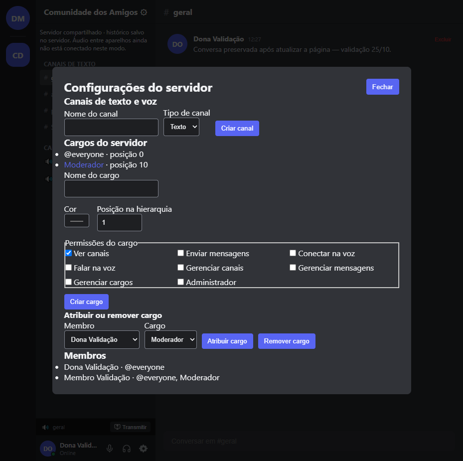

# Persistência, servidor único, amigos, canais e cargos

Data: 2026-10-25, America/Sao_Paulo. Coordenador: Codex principal.
Fonte de autorização: pedido do usuário para implementar com agentes, skills,
REA e colaboração com Claude; depois autorizou continuação autônoma enquanto
ausente. Sem autorização de contratação/publicação neste lote.

## Entrega e aceite

Aceito no escopo **local**, após implementação, checks e revisões independentes.

| Requisito | Implementação e evidência |
| --- | --- |
| Conversas após atualizar | IDs estáveis de servidor/canais; snapshots browser e backend em disco. Browser real enviou mensagem, recarregou e leu o mesmo texto. |
| Servidor único | `guild-community` para todas as contas do mesmo backend. Duas contas em contextos isolados visualizaram canais/histórico comuns. Primeira conta é dona; segunda não assume propriedade. |
| Adicionar amigos | Diretório de perfis públicos, envio por botão/ID/username, pedidos recebidos/enviados, aceite apenas do destinatário. Fluxo completo exercitado na UI. |
| DMs persistentes | Reabertura após F5 preservou mensagem enviada entre duas contas. Testes negam acesso de terceiro e bloqueio revoga leitura. |
| Canais texto/voz | Criação pela administração, atualização na lista e persistência. UI criou `projetos` e `voz-estudos`; segunda conta encontrou ambos. |
| Cargos | Criação, permissões em bigint, posição, cor e atribuição/remoção. UI atribuiu Moderador à segunda conta; gestão de canais apareceu para ela após atualização. |
| Falhas de armazenamento | Gravação precede confirmação; falha não perde rascunho nem confirma mensagem; rollback e preservação de arquivo corrompido testados. |
| Retenção | Janela de 10 dias. Backend remove textos expirados do JSON ativo na abertura, antes de transações e a cada hora. Probe independente com 11 dias confirmou ausência física do texto no arquivo ativo. |

Captura inspecionada do painel após criação/atribuição:

## Divisão e colaboração

- Arquiteto `plano_persistencia`: contrato inicial; depois revisão independente,
  sem escrever implementação. Apontou corrida inicial e snapshot inválido;
  correções e testes foram reexaminados. REV-25FINAL e REV-25C aprovados.
- Dados `dados_persistentes`: sete arquivos de serviços/contratos e três novos
  testes de snapshots, reinício, erros de disco e autorização.
- Frontend `interface_comunidade`: App, componentes de canais/amigos/login/chat,
  painel de servidor, navegação por teclado e testes de interação. Arquivos
  liberados antes das revisões. Atividades fictícias não aparecem no modo real
  compartilhado; presença remota não é afirmada como sincronizada.
- Backend `backend_compartilhado`: API, sessão, armazenamento atômico, lock,
  retenção e testes HTTP. Sem editar arquivos dos outros implementadores.
- Segurança `revisao_seguranca`: revisão somente leitura e probes HTTP; a
  hipótese de atribuição indevida de ADMINISTRATOR não se reproduziu, pois as
  proteções já existiam. SEC-25R aprovou também a correção da retenção.
- Principal: adaptadores HTTP, bootstrap, scripts/configuração, integração,
  correções de corridas, browser real, documentação e aceite.
- Claude Code: commits paralelos observados, incluindo `fd75dd5` com migrações
  Supabase e `e5ff9c1` com endpoints IPC. SQL, arquivos REA e main IPC dele foram
  preservados. O plano compartilhado delimita as responsabilidades. Não houve
  canal direto de mensagens disponível nem confirmação de leitura deste lote;
  não atribuímos ao Claude implementação ou revisão que ele não confirmou.

Foram usados somente mecanismos nativos, até três especialistas simultâneos.
Nenhum subagente foi autorizado a redelegar. O índice do grafo estava antigo
(15/10), com arquivos alterados/não rastreados; a análise usou fontes atuais.

## Verificação final

Snapshot global do diretório compartilhado às **12:40:59**; inclui também
testes de referência adicionados por trabalho paralelo:

- `npm test`: **287 testes / 51 arquivos passaram**, saída 0.
- `npm run lint`: TypeScript passou, saída 0.
- `npm run build`: renderer e desktop main ESM/preload CJS passaram, saída 0.
- `node scripts/build-release.mjs`: manifesto regenerado após o build;
  auditoria local passou sem violações detectadas. Não publicou release.
- `node scripts/smoke-desktop.mjs`: Electron 35.7.5, `ok:true`, sandbox,
  contextIsolation, ponte IPC, captura recusada e probe CSP bloqueado.
- `python -m unittest discover -s tests`: **39 testes passaram**.
- `git diff --check` e `node --check` dos scripts novos passaram.
- `node scripts/dev-shared.mjs`: API 8787 e Vite 5173 iniciaram; proxy
  `/api/health` respondeu `{ok:true,mode:'shared'}`; página abriu em login
  compartilhado. Encerramento real liberou lock e portas.
- Backend de validação em 8788 foi reiniciado com a mesma pasta de dados;
  sessões e histórico das duas contas fictícias continuaram disponíveis.

Avisos não bloqueantes: bundle renderer ~808 kB (~238 kB gzip); aviso Node de
localStorage em testes. A primeira execução global encontrou manifesto antigo
após build; regeneração e execução sequencial resolveram a auditoria.

Dados de UI foram contas inteiramente fictícias em pasta separada
`.local-data/validation-20261025`, excluída do Git. A pasta padrão de dados do
usuário não foi preenchida com essas contas. Nenhum token ou senha foi colocado
no relatório. Cache Python alterado pelo check foi restaurado aos bytes prévios.

## Estado aprovado por hash

| Arquivo | SHA-256 |
| --- | --- |
| `App.tsx` | `561DC73B57E23A8FC6FC0017D084A7FA7EC623F4F59E8D30BFDE8843E02B348D` |
| `remote-app-services.ts` | `6006DC6FA1FEFD0C1CEAC86C8E569FE79EDE7B29599C811D712DEA25FEBF8653` |
| `shared-server.ts` | `B04A1628EF2CE6D6DE9EE671824B6AEC7308DE9E7A9C864B0810FDFF5FBDBBDC` |
| `shared-store.ts` | `21AE09832F72205DBCFAB6DA04019FCBCB2FB19E1A9C8626A3ADF902DC06A822` |
| `retention.ts` | `87DB5696D7A78E5A0B6D57204E47F922893E6522CD154DE00656313FB09CEDF2` |
| `AGENTS.md` preservado | `F305F523B90CE664AB0F206BF8CCA4FA8BA3D3EF18AFEC0D4DDDD8B2EBAC4262` |

Mudanças posteriores invalidam o aceite dos trechos afetados e exigem checks
pertinentes novamente. Configuração preexistente `.codex/config.toml` preservada.
`dist-release/release-manifest.json` foi atualizado porque audita o build atual.
Nenhum commit, push ou deploy foi realizado pelo Codex neste lote.

## REA, execução e limites

A skill `reverse-engineer-anything` e a ferramenta REA analisaram o app.asar
Discord instalado 1.0.9265 sem executá-lo. Evidência pai
`ev_b941228591019e106dd2d4305aac92ec1a6fb9271ff5ec0933e3ce9b52de82ce`, resumo
`ev_be636bd2da7e82c81d1f47efc5fd697461ad59559f4cb30fdaae8a72447a8983`.
SHA-256 `0025c02c7241045a12464309604ec4d5b8ec7ed2ce43cce05d5dacb8f253f672`.
Cobertura parcial por orçamento; não houve prova das regras remotas de cargos,
armazenamento ou canais do Discord. O produto próprio reutiliza seus contratos
de permissões e testes; isto não é validação de reprodução integral.

Para iniciar a entrega: **`npm run shared`**, abrir
**`http://127.0.0.1:8787`** e cadastrar a conta administradora. Passos completos,
pré-requisitos, modo de desenvolvimento e recuperação de lock estão no README.

Limites explícitos:

- Backend JSON de processo único, apropriado à execução local validada; não é
  um serviço já publicado. Outras máquinas precisam alcançar o mesmo backend.
- GitHub Pages é estático; Supabase/Google OAuth remotos e migrações paralelas
  não são ativados automaticamente por esta implementação.
- Canais de voz são criados e salvos, mas áudio/tela entre aparelhos ainda não
  estão ligados ao modo compartilhado. Captura/simulação ficam bloqueadas nele.
- Browser local e backend são bases diferentes, sem importação automática.
  Históricos antigos locais são recuperados separados, sem fusão presumida.
- Retenção remove texto do arquivo ativo, sem garantia de apagar blocos antigos
  do disco ou backups externos. TLS, operação pública e E0 remoto não aprovados.
- O bloqueio de escrita é coordenação instrucional, não sandbox técnico.

Obsidian foi consultado; ai-memory falhou por conexão local recusada, sem
reiniciar/configurar o serviço. Não foi inventado histórico indisponível.
