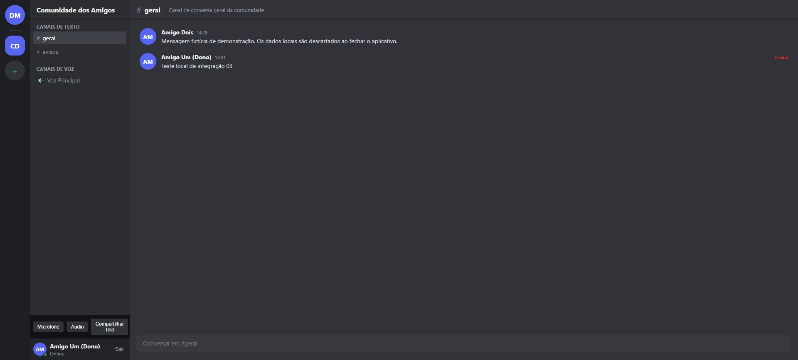
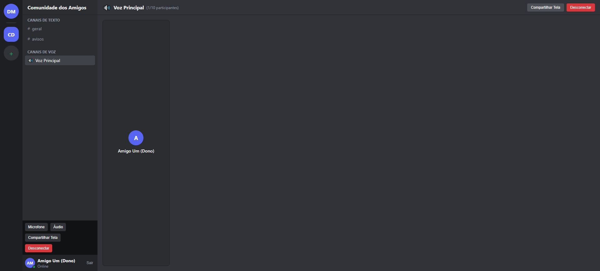

# LOCAL-03 — Integração da aplicação local

Data: 2026-10-14. Responsável: principal/orquestrador. Autorização: continuidade solicitada pelo usuário e D-16. Aceite restrito à composição local e aos trechos revisados; não conclui etapas integrais do produto.

## Resultado

O entrypoint agora monta o App pelo bootstrap assíncrono e entrega instâncias independentes de autenticação mock, comunidades, mensagens, amizades, presença, mídia mock e controlador de chamadas em memória. A comunidade, seus canais e os participantes são fictícios; os dados desaparecem ao reiniciar.

A seleção de voz usa o tipo do canal, aceitando IDs gerados pelos serviços. O login distingue os contratos legado e moderno. O formulário de amizade aguarda o resultado assíncrono antes de apresentar sucesso. Os controles laterais quebram linha para manter “Desconectar” dentro do painel de 240 px.

## Verificação e revisão

- Quatro testes novos cobrem os seeds, isolamento entre factories e a fronteira de montagem/desmontagem. O teste de bootstrap usa `createRoot` mockado; não demonstra efeitos React ou interação.
- O principal verificou a interface no Brave, em loopback: canais geral/avisos, envio e exclusão de mensagem própria, aceite do pedido fictício (amigos 1→2; pendentes 1→0), rejeição de autoamizade sem falso sucesso, entrada/saída da sala simulada e logout/login mock. Nenhum erro ou warning apareceu na consulta ao console.
- Após o ajuste, os quatro botões ficaram dentro do painel lateral; seu botão de desconexão reduziu a sala de 1 para 0 participantes.
- LOCAL-REV-03 e LOCAL-UI-REV-03: revisão independente aprovada nos arquivos/trechos atribuídos. A implementação interna dos módulos MEDIA não integrou essa revisão.
- Comandos, resultados e hashes: [evidências](integracao-local-03-evidencias.json). O ambiente continua recebendo alterações de outra execução; os resultados são snapshots datados.

## Limites e próximo trabalho

Não foram ativados OAuth, banco remoto, captura, transmissão ou provedores. O controlador manipula estado em memória; seu corte de orçamento não comprova suspensão financeira real. E0 permanece BLOQUEADO; E1/E2, instalador, Windows 11 e piloto não foram aceitos. O smoke Electron verifica isolamento/CSP/recusa de captura, não áudio entre computadores.

O botão de mensagem direta ainda não abre uma conversa; presença não tem assinatura reativa na UI e pedidos pendentes precisam distinguir entrada/saída. Estes são próximos trabalhos locais, com testes de integração próprios. A interface principal do Discord original não foi observada: esta entrega não comprova fidelidade visual REA.

Registros anteriores que chamam IDENTITY, TEXT ou MEDIA de “concluídas” descrevem implementações locais; os aceites integrais seguem pendentes dos portões e evidências reais. AGENTS.md foi preservado.
